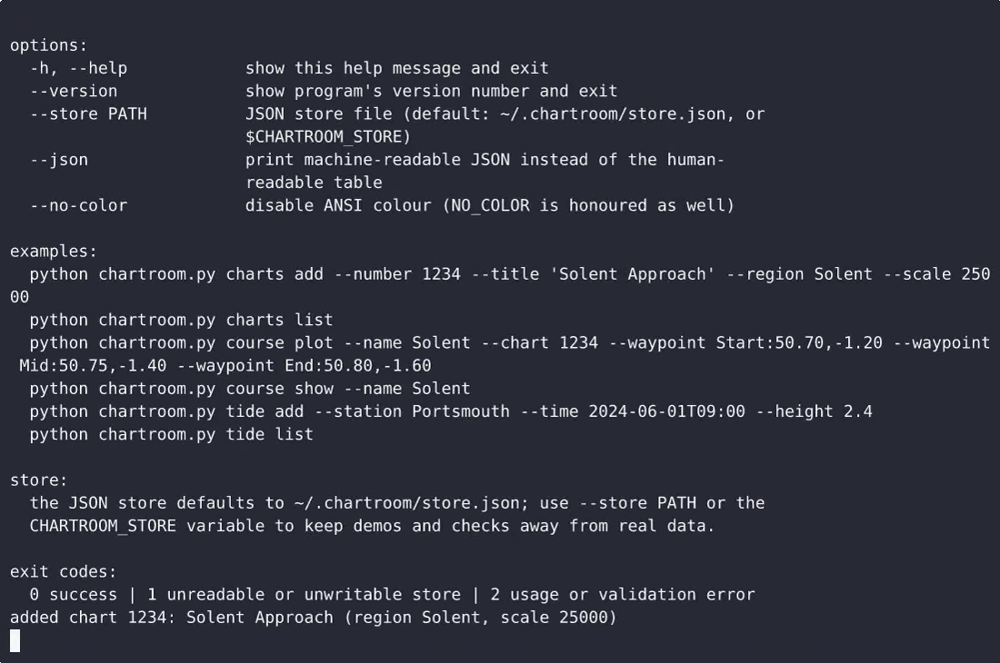
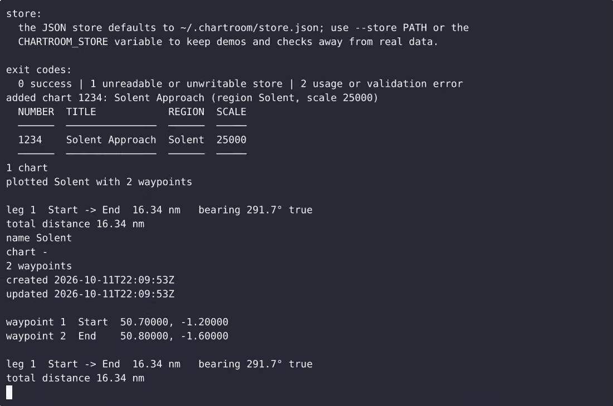

# Chartroom — complete Full-stack app command-line tool example app

Chartroom is a single-file, standard-library-only Python command-line tool for small-boat navigation paperwork: it keeps a local inventory of nautical charts (number, title, region, scale), plots named courses from or…. That's **Chartroom** — a Apache-2.0-licensed, open-source command-line tool in Full-stack app you can self-host and modify freely. Fork Chartroom, run it, or [remix it on cenius.ai](https://cenius.ai/marketplace/p/chartroom?ref=gh&utm_campaign=chartroom-webapp) for a custom Chartroom build with full rebrand rights.


[](LICENSE)  [](https://cenius.ai)

[](https://cenius.ai/marketplace/p/chartroom?ref=gh&utm_campaign=chartroom-webapp)

> **▶ [Open & edit in cenius.ai](https://cenius.ai/marketplace/p/chartroom?ref=gh&utm_campaign=chartroom-webapp)** — one click to an editable workspace: describe changes in plain English, get an instant preview, one-click deploy and host. Modifications made on the platform come with full rebrand & relicense rights.

_Local clone? See [Quick start](#quick-start) below. cenius.ai is the zero-setup path._

## Demo


📽 **[Demo video on cenius.ai](https://cenius.ai/marketplace/p/chartroom?ref=gh&utm_campaign=chartroom-webapp)** — the complete run-through · [MP4](.github/media/demo.mp4)

## Screenshots

 

## Features

- Nautical chart inventory
- Course plotting tool
- Tide table log

## Quick start

```bash
./install.sh   # installs dependencies + seeds demo data
```

See [`INSTALL.md`](INSTALL.md) for full setup and usage instructions.

## Usage guide

### Overview

This is **Chartroom** — a command-line tool. This document covers the surface area you can use, with copy-pasteable examples for each entry point. For setup, see `INSTALL.md`.

### Quickstart

```bash
this-tool --help
## or, if installed from source without symlink:
python -m Chartroom --help
```

### Commands

This CLI exposes **3** subcommands. Each was extracted from the source.

| Command | Source file |
|---------|-------------|
| `this-tool charts` | `chartroom.py` |
| `this-tool course` | `chartroom.py` |
| `this-tool tide` | `chartroom.py` |

#### Per-command help

```bash
this-tool --help                # top-level help
this-tool charts --help    # help for `charts`
```

### Worked example

1. Verify the CLI is on your PATH: `which this-tool` (or run via `cargo run --`/`python -m`).
2. Show all subcommands: `this-tool --help`.
3. Try the first detected subcommand:

```bash
this-tool charts --help
```

### Reference

#### Entry points

_No explicit entry points declared in this project's manifests._

#### Surface index (auto-extracted)

| Kind | Title | Source file |
|------|-------|-------------|
| command | `charts` | `chartroom.py` |
| command | `course` | `chartroom.py` |
| command | `tide` | `chartroom.py` |

### Next steps

- Read [INSTALL.md](./INSTALL.md) if anything in the Quickstart didn't work.
- Inspect `.env.example` for the full list of environment variables this project understands.
- See [README.md](./README.md) for the architecture diagram + feature list.

_Full guide: [`USAGE.md`](USAGE.md)_

## Architecture

No external services required: the entire command-line tool runs from this Full-stack app repo (24 files). Top-level layout: `examples/`, `tests/`. The setup script (`install.sh`) installs runtime dependencies and loads a starter dataset so the app is immediately usable. For environment-specific setup, see [`INSTALL.md`](INSTALL.md).

## FAQ

### What does it take to self-host Chartroom?

Clone this repository and run `./install.sh`, then start the app as described in [`INSTALL.md`](INSTALL.md). Chartroom is fully self-hostable — no external services are required to try it.

### Is there a no-code way to modify Chartroom?

Describe what you want changed on [cenius.ai](https://cenius.ai/marketplace/p/chartroom?ref=gh&utm_campaign=chartroom-webapp) — no code editing needed; the platform produces a fresh build you can download and deploy.

### What technologies are in Chartroom's stack?

Chartroom is a Full-stack app application — and this repository holds the complete, runnable source, not a stripped-down sample. Highlights include nautical chart inventory.

### Does the Chartroom license allow commercial use?

The code is under the Apache-2.0 license, which allows commercial use without restriction. You can build, sell, and deploy it freely. Full text: [LICENSE](LICENSE).

### How do I make Chartroom my own brand?

Yes. The MIT license lets you remove the original branding and ship under your own name. For a guided approach, [remix it on cenius.ai](https://cenius.ai/marketplace/p/chartroom?ref=gh&utm_campaign=chartroom-webapp): you get a fresh build with full rebrand and relicense rights.

## License & rebranding

Released under the [Apache License 2.0](LICENSE) (© 2026 Cenius AI) — free for personal and commercial use. The Cenius name/logo are trademarks (see NOTICE).

**Need a customized version?** [Remix this app on cenius.ai](https://cenius.ai/marketplace/p/chartroom?ref=gh&utm_campaign=chartroom-webapp) — modifications made on the platform come with **full rebrand & relicense rights** over your derivative.

## Built with cenius.ai

This entire application — code, design, seeded demo data — was generated on **[cenius.ai](https://cenius.ai)** from a plain-English description.

- 🚀 [Build your own app on cenius.ai](https://cenius.ai)
- 🎛️ [Remix Chartroom on the marketplace](https://cenius.ai/marketplace/p/chartroom?ref=gh&utm_campaign=chartroom-webapp) — open it in a workspace, prompt for changes, and ship your own version.

More open-source apps: [the Cenius-ai catalog](https://github.com/Cenius-ai) · [showcase index](https://github.com/Cenius-ai/showcase)
